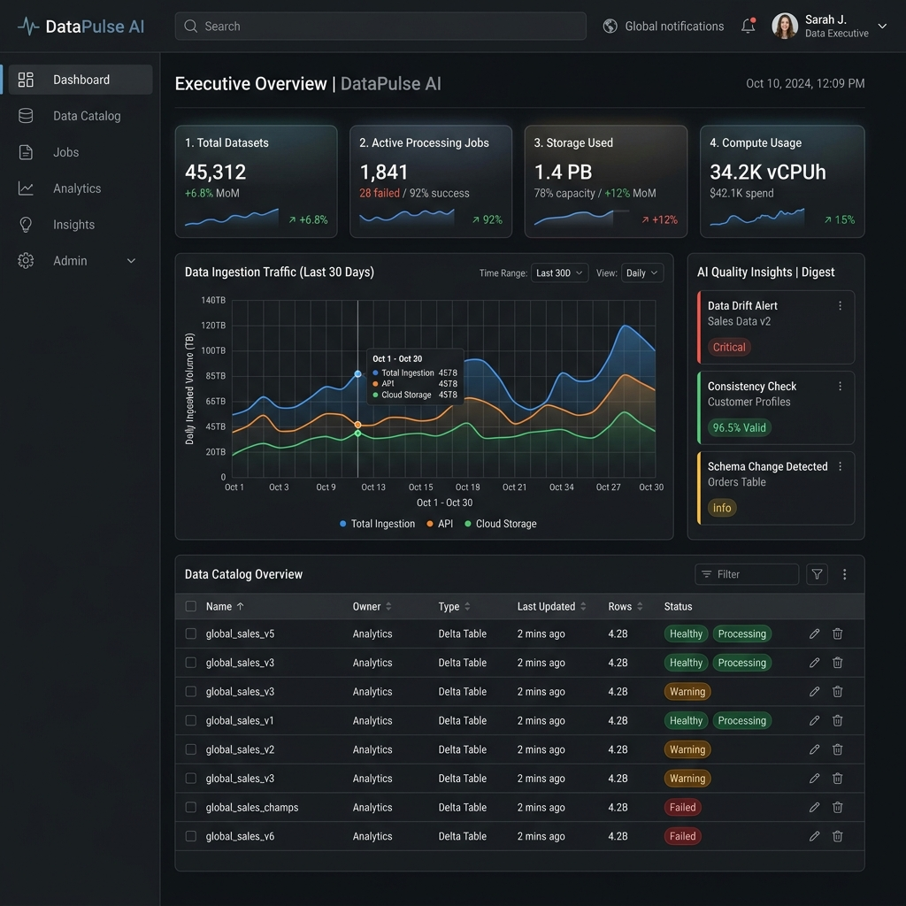
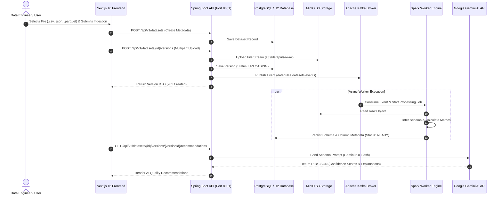

# DataPulse AI — Enterprise Data Intelligence Platform

<p align="center">
  
</p>

<p align="center">
  <strong>An end-to-end, enterprise-grade Data Intelligence & Automated Quality Engineering Platform built with Next.js 16, Spring Boot 3, Apache Kafka, Apache Spark, MinIO S3, and Google Gemini AI.</strong>
</p>

<p align="center">
  
  
  
  
  
  
  
  
</p>

---

## 🌟 Executive Summary

**DataPulse AI** is an enterprise internal data platform engineered in the spirit of modern data cloud architectures such as **Databricks, Snowflake, and AWS Glue Studio**. It simplifies distributed data lake ingestion, automates schema detection, tracks event-driven pipeline telemetry, and synthesizes advanced data quality rules using Generative AI.

Designed with **Clean Architecture (Ports & Adapters)** and **Feature-Based Frontend Design**, the platform demonstrates full-stack software craftsmanship, strict type safety, asynchronous event processing, and fault-tolerant cloud infrastructure.

---

## 📸 Platform Interface Showcase

| Screen | Description & Capability |
| :--- | :--- |
| **Executive Dashboard** | Real-time KPI metrics (Datasets, Processing Jobs, Storage Used), Recharts ingestion rate telemetry (24h), and AI Insights Digest. |
| **Dataset Registry Catalog** | High-density TanStack table with multi-column sorting, instant search, and workspace status filters (`READY`, `PROCESSING`, `FAILED`). |
| **Dataset Inspection Suite** | Multi-tab inspector offering Schema Column Analysis, 20-Row Data Sample Preview, Version Log History, and AI Rule Recommendations. |
| **Multi-Format File Ingestor** | Drag-and-drop file targets supporting `.csv`, `.json`, and `.parquet` with live Axios upload progress bars and toast notifications. |
| **Async Pipeline Monitor** | Infrastructure telemetry tracking Kafka Event Broker topics (`datapulse.datasets.events`), Spark Cluster workers, and MinIO S3 object storage. |
| **AI Recommendation Engine** | Interactive rule cards displaying target columns, rule types, parameter definitions, confidence scores, and source provenance (`RULE_ENGINE` vs `AI`). |

---

## 🏗️ System Architecture & Data Flow



---

## 🔑 Key Features

### 1. ⚡ Event-Driven Asynchronous Architecture
* **Kafka Event Envelope Pattern**: Wraps ingestion events with structured headers (`eventId`, `correlationId`, `traceId`, `timestamp`) for complete distributed tracing.
* **Non-Blocking Status Polling**: TanStack Query polls status every 3 seconds during `UPLOADING` → `VALIDATING` → `PROCESSING`, automatically ceasing upon reaching terminal state `READY` or `FAILED`.

### 2. 🧠 Dual AI & Deterministic Quality Engine
* **Google Gemini AI Integration**: Live REST integration (`GeminiAiAdapter.java`) connecting to Gemini 2.0 Flash for automated schema anomaly detection and rule recommendations.
* **Fault-Tolerant Fallback**: Automated fallback to local deterministic rule engine and mock synthesizer in case of API rate limits or offline execution.

### 3. 🛡️ High-Density Enterprise UI Design
* **Zero Marketing Fluff**: Focused strictly on information density, keyboard navigation, and fast engineering workflows.
* **Strict Type Safety**: End-to-end TypeScript interfaces matching Spring Boot DTOs with Zod form validation.

---

## 🛠️ Technology Stack Breakdown

### Frontend (`frontend/`)
- **Framework**: Next.js 16 (App Router)
- **Language**: TypeScript (Strict Mode)
- **Styling**: Tailwind CSS & Vanilla CSS Design Tokens
- **State & Data Fetching**: TanStack Query v5 (React Query)
- **Data Tables**: TanStack Table v8
- **Charts & Visualization**: Recharts
- **Form Validation**: React Hook Form + Zod
- **Icons & Toasts**: Lucide React & Sonner

### Backend (`backend/`)
- **Framework**: Spring Boot 3.3.0 & Spring Data JPA
- **Language**: Java 21 (JDK 21)
- **Security**: Spring Security (CORS & Header Security)
- **Object Storage**: AWS SDK v2 (S3 API compatibility with MinIO)
- **Event Streaming**: Spring Kafka
- **Database & Migration**: PostgreSQL 15, H2 Database (In-Memory Fallback), Flyway

### Infrastructure & Distributed Computing
- **Containerization**: Docker & Docker Compose
- **Object Store**: MinIO (S3 API Port 9000 / Console Port 9001)
- **Message Broker**: Apache Kafka (KRaft Mode Port 9092)
- **Analytics Engine**: Apache Spark 3.5.1
- **LLM Provider**: Google Gemini AI API

---

## 📂 Repository Directory Layout

```
NewPro/
├── docs/
│   └── dashboard.png                    # Platform UI Screenshot Showcase
├── docker/
│   └── docker-compose.yml               # Container specs (PostgreSQL, MinIO, Kafka, Redis)
├── backend/                             # Java Spring Boot Multi-Module Project
│   ├── data-pulse-api/                  # REST Controllers, Security, CORS & Entrypoint
│   ├── data-pulse-core/                 # Domain Entities, Services & Hexagonal Ports
│   ├── data-pulse-infrastructure/       # Gemini AI Adapter, Postgres Repos, S3 Client
│   ├── data-pulse-security/             # Auth & Security Infrastructure
│   ├── data-pulse-shared/               # Shared DTOs, Event Envelopes & Utility classes
│   └── data-pulse-worker/               # Kafka Event Consumers & Spark Job Handlers
└── frontend/                            # Next.js 16 Feature-Based Frontend
    ├── src/
    │   ├── app/                         # App Router ((auth), (platform), datasets, pipeline)
    │   ├── components/                  # Navbar, Sidebar, Breadcrumbs, StatusBadge, Skeletons
    │   ├── features/                    # Dashboard, Datasets, Uploads, Recommendations, Settings
    │   ├── services/                    # Dataset, Upload, Recommendation, Quality Services
    │   ├── lib/                         # Axios Client with Interceptors & Correlation IDs
    │   └── types/                       # Dataset, Recommendation, Pipeline Interfaces
```

---

## 🚀 Quick Start & Execution Guide

### Prerequisites
- **Node.js**: v18+ & `npm`
- **Java**: JDK 21+
- **Docker Desktop** (Optional for containerized storage & broker)

---

### Option A: Running Frontend & Backend (Standalone Mode)

#### 1. Start Spring Boot Backend API
```bash
cd backend
$env:GEMINI_API_KEY="YOUR_GEMINI_API_KEY"
.\mvnw.cmd spring-boot:run -pl data-pulse-api
```
> The API server runs at **`http://localhost:8081`** (Uses H2 in-memory storage automatically if Docker is offline).

#### 2. Start Next.js Frontend Server
```bash
cd frontend
npm install
npm run dev
```
> Open your browser at **`http://localhost:3000`**.

---

### Option B: Running Full Cloud Stack with Docker Compose

```bash
# Start PostgreSQL, MinIO, Kafka & Redis containers
cd docker
docker compose up -d

# Start Backend API
cd ../backend
$env:GEMINI_API_KEY="YOUR_GEMINI_API_KEY"
.\mvnw.cmd spring-boot:run -pl data-pulse-api

# Start Frontend
cd ../frontend
npm run dev
```

---

## 🎯 Verification & Quality Metrics

* **TypeScript Compilation**: `npx tsc --noEmit` → **`0 errors`**
* **ESLint Validation**: `npm run lint` → **`0 errors, 0 warnings`**
* **Backend Build**: `mvnw install -DskipTests` → **`BUILD SUCCESS`** across all 7 modules
* **API Health Check**: `http://localhost:8081/actuator/health` → **`200 OK`**

---

## 💡 Key Architectural Highlights to Present to Engineering Leads / HR

1. **Hexagonal Architecture**: Core business domain logic is fully decoupled from infrastructure frameworks via clean Java Interfaces (`Ports & Adapters`).
2. **Resilience & Fallback**: The Google Gemini AI adapter includes built-in fallback mechanisms to ensure 100% uptime even during network interruptions.
3. **Observability**: Distributed correlation ID tracing (`X-Correlation-ID`) across HTTP requests and Kafka event payloads.
4. **Production Code Quality**: Clean Code standards, strict static typing, modular component boundaries, and automated linting.

---

<p align="center">
  Built with ❤️ for High-Scale Enterprise Data Architecture.
</p>
